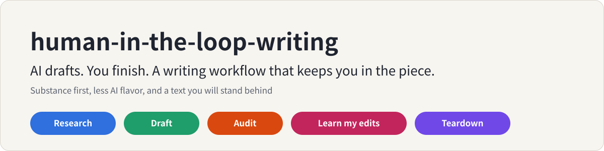
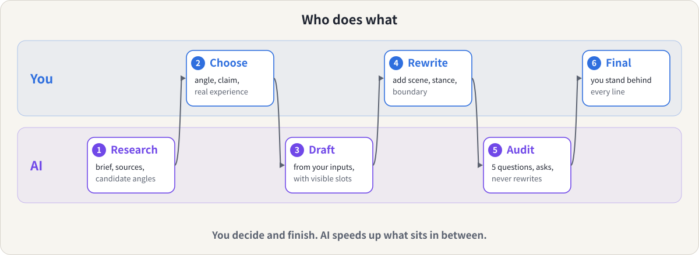
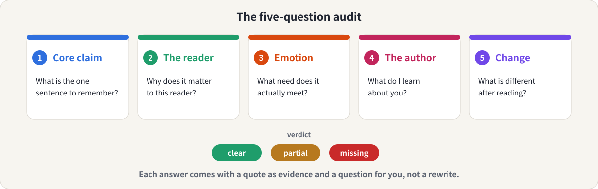

<p align="center">
  
</p>

<p align="center">
  <b>English</b> &nbsp;|&nbsp; <a href="README.zh-CN.md">简体中文</a>
  &nbsp;|&nbsp; <a href="LICENSE">MIT License</a>
</p>

A [Claude](https://claude.ai) skill for people who **write with AI and want the result to still sound like them.**

AI is fast at understanding a topic, organizing material and producing a first draft. It can't supply your judgment. This skill turns that into a repeatable workflow: AI does the speed-up work, and you stay in the piece.

## Is this for you?

- You use AI to write, and the result is smooth, tidy and correct, but empty. You read it back and something is off.
- You want a process you can repeat, not a fresh prompt every time.
- You've edited AI drafts many times and would like those edits to become rules instead of staying in your head.
- You admire a viral article, but copying its sentences only gets you something that looks similar.
- You write in Chinese or English, for WeChat, Xiaohongshu, LinkedIn, a blog or a newsletter.

## What you get

Five modes. You don't pick one by name; what you say decides.

| You say | Mode | You get |
|---|---|---|
| "Help me understand X before I write about it" | **Research** | A brief: framing, key terms, settled vs contested, cases, candidate angles and structures, every fact labelled by where it came from |
| "Write a first draft of this" | **Draft** | A draft built from your claim and your real experience, with visible slots for what only you can add, and a hand-back list |
| "Is this empty? Does it sound like AI?" | **Audit** | A five-question report with quotes as evidence, hotspots where the author is missing, and questions for you, not a rewrite |
| "Here's the AI draft and my final version" | **Learn my edits** | What you changed, rules inferred from real before/after pairs, and a `voice-profile.md` the skill reads next time |
| "Why did this article work?" | **Teardown** | The mechanisms behind a viral piece that you can borrow, without copying its sentences |

What it won't do: write your final piece, invent your experience, promise to beat AI detectors, or claim to know who wrote a text.

## The idea in 30 seconds

"AI flavor" (AI味) is what text looks like when the author is absent: no stance, no real experience, no trade-offs, only smooth sentences. AI is best at finishing things and worst at holding a position, so the fix is not smoother prose. It is getting the author back in.

So the work is split by who is good at what.

<p align="center">
  
</p>

The audit is the part you'll use most. It asks five questions of any text, and for each one gives a verdict, a quote as evidence and a question for you.

<p align="center">
  
</p>

## See it work

Four real outputs are included, with the body unedited and a short note at the top:

| Request | Mode | Output |
|---|---|---|
| "I know almost nothing about RAG; help me get up to speed before I write for non-technical founders" | Research | [examples/research.en.md](examples/research.en.md) (English) |
| 「帮我写一篇公众号初稿……」(with my claim, experience and boundary) | Draft | [examples/draft.zh.md](examples/draft.zh.md) (中文) |
| 「帮我看看这篇是不是有 AI 味，写得空不空？」 | Audit | [examples/audit.zh.md](examples/audit.zh.md) (中文) |
| 「这是我的 AI 初稿和终稿，总结我改了什么」 | Learn my edits | [examples/learn-edits.zh.md](examples/learn-edits.zh.md) (中文) |

A taste of the audit's verdict on a generic article (translated from the Chinese example):

> Every sentence is correct on its own, but swap the author and the topic and almost nothing needs to change. The problem is that the author is absent: no stance, no real experience, no trade-offs.

And the shape of draft mode's hand-back list, the second-round assignment it gives you (summarized):

> Slots to fill, ranked by value (doing only number 1 is worth it). Stances I wrote on your behalf that you must confirm. Facts to verify.

## It won't make up your life

Every invented anecdote is a small lie in your name. So when the skill drafts, it uses only what you told it. Wherever the piece needs a scene, a number, a feeling or a decision it doesn't have, it leaves a **visible slot** (`[AUTHOR: ...]`) instead of inventing one. It keeps slots to the five that matter most, ranked, and it doesn't write your thoughts or feelings into the text, even tentatively. Opinions it adds on your behalf are marked as stances to confirm.

Research mode labels every fact: from you, from a source (with a link), or from memory and unverified. It never makes up citations, quotes or statistics.

## The helper script

Audit mode can run a small local script that counts surface signals of an absent author: first-person statements, distinct concrete specifics, stock phrases and transitions, tidy lists of three, how even the sentence length is, and paragraphs with nothing specific in them. Chinese and English, standard library only.

```bash
python3 skills/human-in-the-loop-writing/scripts/absence_signals.py article.md
```

Be clear about what it is. It is a set of heuristics that point at places to look, **not** an AI detector. It can't tell who wrote a text, short texts make it noisy, and technical writing legitimately avoids first person. It has only been checked on a few constructed samples and a handful of real outputs, not on a labelled corpus.

## Install

**Claude Code** (personal skill):

```bash
git clone https://github.com/meiluosi/human-in-the-loop-writing.git
cp -r human-in-the-loop-writing/skills/human-in-the-loop-writing ~/.claude/skills/
```

**Claude.ai / Claude desktop:** zip the `skills/human-in-the-loop-writing` folder (so that `SKILL.md` sits inside it) and upload it under Settings → Capabilities → Skills.

## Use

Claude picks the skill from what you ask. For example:

- "Help me write this up. My claim is X, my reader is Y, and here is what happened to me."
- "去AI味：帮我检查这篇是不是空，哪里看不到我。"
- "Review my draft against the five questions."
- "这是 AI 初稿和我的终稿，总结我的修改规则。"
- "Tear down this viral post. What's the mechanism?"

If it doesn't trigger on its own, name it: in Claude Code type `/human-in-the-loop-writing`, or say "use the human-in-the-loop-writing skill" in Claude.ai.

It pairs with [content-topic-decomposer](https://github.com/meiluosi/content-topic-decomposer): that one turns a topic into a content plan, this one turns one item from the plan into a piece you stand behind.

## How well does it work?

Honest answer: only small tests so far. The first version was compared with plain Claude (no skill) on four prompts, one per mode (draft, audit, learn my edits, research). On a checklist written by the author, the skill passed 25 of 25 checks and plain Claude passed 15 of 25.

Plain Claude was strong in two modes: its edit analysis and its RAG primer were good. Where it fell short:

- **Draft:** it added details the user never gave (for example, posting the loss chart to friends) and only admitted part of that in a closing note.
- **Audit:** no five-question structure, and it rewrote the opening around an invented anecdote.
- **Learn my edits:** no voice profile, and a few rules went beyond what the edits showed.
- **Research:** no labelling of where facts came from, and no settled-vs-contested section.

Treat this as a sanity check, not a benchmark: the checklist was written and scored by the author, there were four prompts, and the runs are not published. After the tests the draft mode was tightened (at most five ranked slots, no invented inner life) and the helper script's stock-phrase matching was made more precise, and the examples in this repo are re-runs with the revised version. Issues and examples from your own writing are very welcome.

## What's inside

```
skills/human-in-the-loop-writing/
├── SKILL.md                      # the five modes and principles
├── references/
│   ├── workflow.md               # research and draft in detail
│   ├── five-questions.md         # the audit
│   ├── author-absence.md         # patterns of an absent author, and how to fix them
│   ├── learn-edits.md            # turning your edits into rules
│   └── teardown.md               # learning from viral pieces
├── assets/voice-profile-template.md
└── scripts/
    ├── absence_signals.py        # heuristic signals (stdlib only)
    └── test_absence_signals.py   # run: python3 -m unittest
examples/                         # four real outputs
assets/                           # diagrams used in this README
```

## Credit

The workflow and the five audit questions are adapted from ideas in section 5.1 of the book 《把自己变成一门生意》. This repository is an independent implementation and contains no text from the book.

## License

[MIT](LICENSE)
