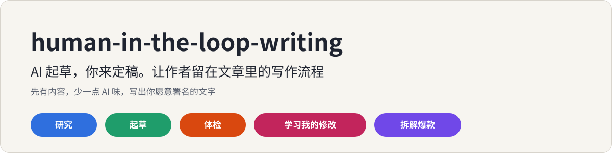
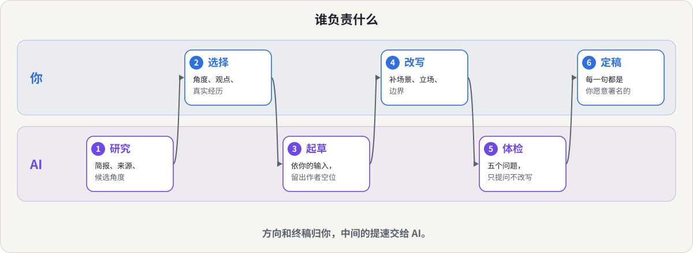
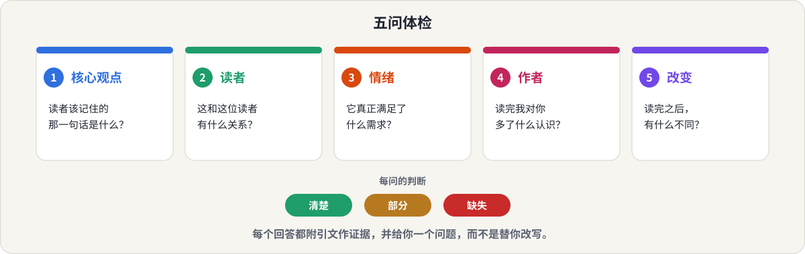

<p align="center">
  
</p>

<p align="center">
  <a href="README.md">English</a> &nbsp;|&nbsp; <b>简体中文</b>
  &nbsp;|&nbsp; <a href="LICENSE">MIT 许可</a>
</p>

一个 [Claude](https://claude.ai) skill，写给**用 AI 写作、又希望成品依然像自己**的人。

AI 擅长理解主题、整理材料、生成初稿，但给不了你的判断。这个 skill 把这件事变成可以反复执行的流程：AI 负责提速，你留在文章里。

## 这是写给你的吗？

- 你用 AI 写作，成品通顺、整齐、没有错误，但很空。读完总觉得哪里不对。
- 你想要一套能重复执行的流程，而不是每次重新写提示词。
- 你改过很多次 AI 的初稿，希望这些修改变成规则，而不是只留在脑子里。
- 你很欣赏某篇爆款，但照搬它的句子，最后只得到表面相似的东西。
- 你用中文或英文写作，发在公众号、小红书、LinkedIn、博客或邮件通讯上。

## 你会得到什么

五种模式。你不用按名字选，你怎么说，它就进哪种。

| 你说 | 模式 | 你得到 |
|---|---|---|
| "我要写 X，先帮我弄懂" | **研究** | 一份简报：框架、关键术语、已有共识与争议、案例、候选角度和结构，每个事实都标明来源 |
| "帮我写一篇初稿" | **起草** | 依据你的观点和真实经历写成的初稿，留出只有你能补的空位，并附交还清单 |
| "这篇空不空？有没有 AI 味？" | **体检** | 五问报告，附引文作证据，指出作者缺席的位置，只给你问题，不替你改写 |
| "这是 AI 初稿和我的终稿" | **学习我的修改** | 你改了什么、从真实前后对照里归纳的规则，以及下次会读取的 `voice-profile.md` |
| "这篇爆款为什么有效？" | **拆解爆款** | 可以借用的机制，而不是照抄它的句子 |

它不会做的事：替你写终稿、编造你的经历、承诺骗过 AI 检测器，或者声称知道一篇文字是谁写的。

## 30 秒讲清思路

"AI 味"是作者缺席时文字的样子：没有立场、没有亲身经历、没有取舍，只有顺滑的句子。AI 最擅长把事情做完整，最不擅长坚持一个立场，所以解法不是把文字改得更顺，而是让作者回到文章里。

所以按"谁擅长什么"分工。

<p align="center">
  
</p>

体检是你最常用到的部分。它对任何文字问五个问题，每个问题给出判断、引文作为证据，以及一个留给你的问题。

<p align="center">
  
</p>

## 看它怎么工作

仓库里有四份真实输出，正文未改动，只在开头加了一小段说明：

| 请求 | 模式 | 输出 |
|---|---|---|
| "我对 RAG 几乎一无所知，想先弄懂再给非技术创始人写文章" | 研究 | [examples/research.en.md](examples/research.en.md)（English） |
| 「帮我写一篇公众号初稿……」（附观点、经历和边界） | 起草 | [examples/draft.zh.md](examples/draft.zh.md)（中文） |
| 「帮我看看这篇是不是有 AI 味，写得空不空？」 | 体检 | [examples/audit.zh.md](examples/audit.zh.md)（中文） |
| 「这是我的 AI 初稿和终稿，总结我改了什么」 | 学习我的修改 | [examples/learn-edits.zh.md](examples/learn-edits.zh.md)（中文） |

体检对一篇泛泛文章的结论节选：

> 每句话单看都没错，但换一个人署名、换一个话题，几乎不用改字。问题的实质是作者不在场：没有立场、没有亲身经历、没有取舍。

起草模式交还清单的结构，也就是它留给你的第二轮作业（概述）：

> 要补的位置，按价值排序（只做第 1 个也值）。我替你写了、需要你确认的立场。需要核实的事实。

## 它不会替你编生活

每一段编造的经历，都是以你的名义说的小谎。所以起草时，它只用你告诉它的内容。凡是文章需要它没有的场景、数字、感受或决定，它会留一个**看得见的空位**（`【作者补：……】`），而不是编一个。空位最多五个，按价值排序；也不会把你的想法和感受写进正文，哪怕是试探性的。它替你写下的观点，都会标成"待你确认的立场"。

研究模式会给每个事实标明出处：来自你、来自某个来源（附链接），或来自记忆且未核实。它不会编造引用、引语或统计数字。

## 辅助脚本

体检模式可以运行一个本地小脚本，统计"作者缺席"的表面信号：第一人称陈述、不同的具体细节、套话和转折词、整齐的三段式、句长是否过于均匀，以及不含任何具体内容的段落。支持中英文，只用标准库。

```bash
python3 skills/human-in-the-loop-writing/scripts/absence_signals.py article.md
```

请清楚它是什么：它只是一组启发式规则，指给你看"该去哪里看"，**不是** AI 检测器。它判断不了一篇文字是谁写的；文本太短时结果很不稳；技术文档本来就不用第一人称。它目前只在几份构造的样本和少量真实输出上检查过，没有在带标注的语料上验证过。

## 安装

**Claude Code**（个人 skill）：

```bash
git clone https://github.com/meiluosi/human-in-the-loop-writing.git
cp -r human-in-the-loop-writing/skills/human-in-the-loop-writing ~/.claude/skills/
```

**Claude.ai / Claude 桌面端**：把 `skills/human-in-the-loop-writing` 文件夹打成 zip（`SKILL.md` 在文件夹里面），在 设置 → 能力 → Skills 中上传。

## 使用

Claude 会根据你的需求自动调用这个 skill。例如：

- "帮我写这篇。我的观点是 X，读者是 Y，下面是我自己的经历。"
- "去 AI 味：帮我检查这篇是不是空，哪里看不到我。"
- "按五个问题检查我的初稿。"
- "这是 AI 初稿和我的终稿，总结我的修改规则。"
- "拆解这篇爆款，它的机制是什么？"

如果它没有自动触发，可以直接点名：在 Claude Code 里输入 `/human-in-the-loop-writing`，在 Claude.ai 里说"用 human-in-the-loop-writing 这个 skill"。

它和 [content-topic-decomposer](https://github.com/meiluosi/content-topic-decomposer) 是一对：后者把一个主题拆成内容规划，这个 skill 把规划里的某一项写成你愿意署名的文章。再由 [content-card-designer](https://github.com/meiluosi/content-card-designer) 把成稿做成图文卡片、封面或头像。

## 效果如何？

诚实地说：目前只做过小规模测试。我把第一版 skill 和不带 skill 的 Claude 放在四个问题上对比，每种模式一个（起草、体检、学习修改、研究）。用作者自己写的检查清单打分，带 skill 的版本通过 25 项中的 25 项，不带 skill 的通过 25 项中的 15 项。

不带 skill 的 Claude 在两个模式上表现不错：修改分析和 RAG 入门简报都写得好。它的不足在于：

- **起草**：补写了用户没给的细节（比如把 loss 曲线截图发朋友圈），只在结尾备注里承认了一部分。
- **体检**：没有五问结构，还围绕一段编造的轶事改写了开头。
- **学习修改**：没有 voice profile，有几条规则超出了修改本身能支持的范围。
- **研究**：没有标注事实来源，也没有"共识与争议"部分。

请把它当作一次自查，而不是正式基准：检查清单由作者编写并打分，只有四个问题，运行记录没有公开。测试之后，起草模式做过收紧（空位最多五个并排序、不写作者的内心活动），辅助脚本的套话匹配也改得更精确，仓库里的示例是用修改后的版本重新运行的。欢迎提 issue，也欢迎贡献你自己写作的示例。

## 目录

```
skills/human-in-the-loop-writing/
├── SKILL.md                      # 五种模式与原则
├── references/
│   ├── workflow.md               # 研究与起草的细节
│   ├── five-questions.md         # 体检
│   ├── author-absence.md         # 作者缺席的表现及修法
│   ├── learn-edits.md            # 把你的修改变成规则
│   └── teardown.md               # 从爆款里学习
├── assets/voice-profile-template.md
└── scripts/
    ├── absence_signals.py        # 启发式信号（仅标准库）
    └── test_absence_signals.py   # 运行：python3 -m unittest
examples/                         # 四份真实输出
assets/                           # README 里用到的示意图
```

## 致谢

工作流和五个体检问题改编自《把自己变成一门生意》5.1 节中的思路。本仓库为独立实现，不包含该书原文。

## 许可

[MIT](LICENSE)
